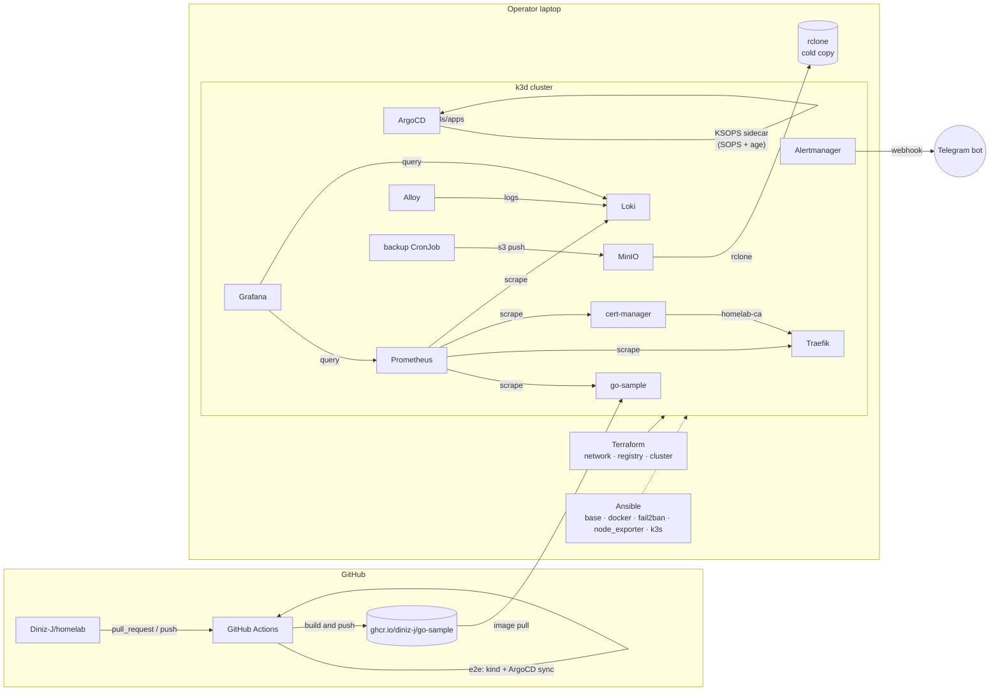

# Architecture

## Overview

## Layers

### 1. Terraform

The main stack provisions the local cluster through standard providers:

- **compute/** — a k3d cluster (via the `kind` or `k3d` provider / `null_resource`),
  with the desired version and port mappings.
- **network/** — a dedicated Docker network for the cluster and MinIO.
- **storage/** — host-path volumes and a MinIO bucket pre-created for backups.
- **registry/** — a local image registry so the CI and local workflows can
  push ephemeral images without hitting Docker Hub rate limits.

State lives locally, in-tree under `terraform/.terraform/` and ignored by git.
Secrets referenced by Terraform are SOPS-encrypted under `secrets/`.

Modules are shaped so a future `compute/cloud/` sibling can target Oracle Cloud,
Hetzner or AWS once there's a way to pay. The root `terraform/main.tf` picks
the target through a variable.

### 2. Ansible

The host-level story. Ansible isn't strictly needed for a k3d-only workflow, but
it's part of what the lab demonstrates, and it's ready for the day there's a
real VM to point at.

Roles:

- `base` — users, SSH hardening, timezone, unattended-upgrades.
- `docker` — Docker CE from upstream repo.
- `fail2ban` — SSH jail.
- `node_exporter` — systemd service, scraped by Prometheus.
- `k3s` — single-node install, Traefik disabled.

`base`, `docker` and `fail2ban` have Molecule scenarios with the Docker driver.
`k3s` is validated against a Multipass VM, because Docker-in-Docker with
systemd and cgroups is not worth fighting.

### 3. Kubernetes (local k3s via k3d)

Bootstrap is a one-time manual `kubectl apply` of the ArgoCD manifests under
`k8s/bootstrap/argocd/`. After that, ArgoCD syncs everything under `k8s/apps/`
from this repo.

- **Ingress**: Traefik v3. In local mode, exposed via `k3d`'s loadbalancer on
  `127.0.0.1`. Hostnames use `*.homelab.localhost`, which resolves to `127.0.0.1`
  with no `/etc/hosts` edit.
- **TLS**: cert-manager with a `selfSigned` ClusterIssuer locally, trusted by
  importing the root CA via mkcert. CI uses Let's Encrypt staging to keep the
  path real without burning rate limits.
- **Observability**:
  - Grafana Alloy as the single collector agent.
  - Prometheus scrapes node_exporter, kube-state-metrics, app `/metrics`.
  - Loki stores logs, Alloy pushes.
  - Grafana ships with provisioned dashboards.
  - Alertmanager routes to a Telegram webhook (the one component that touches
    the outside world).
- **Secrets**: SOPS + age. Private key lives on the operator's disk; never in
  the repo.
- **Backup**: CronJob dumps the k3s datastore and manifests to the local MinIO
  bucket. `rclone` copies the bucket to a cold directory on disk.
- **Demo workload**: a small Go app exposing `/healthz`, `/metrics` and `/boom`,
  used to exercise alerting and ArgoCD rollback.

### 4. CI

End-to-end is the headline:

1. Spin a kind cluster on the GitHub runner.
2. `terraform apply` against the local target.
3. Install ArgoCD, point it at the PR branch.
4. Wait for all Applications to go Synced + Healthy.
5. Curl the smoke endpoints.
6. Tear everything down.

A green CI run is the lab's proof of correctness.

## Resource budget

The full stack (Prometheus + Loki + Grafana + Alloy + ArgoCD + Traefik +
cert-manager + MinIO + demo app) fits in roughly 4 GB of RAM on k3d. A GitHub
Actions `ubuntu-latest` runner (7 GB) has enough headroom for the e2e.

## What the lab *doesn't* try to do

- **HA**: single node by design. Not the point.
- **Multi-tenant**: no namespace isolation beyond defaults.
- **Live public URL**: not until there's a cloud target. See
  [ADR 0004](adr/0004-local-first-homelab.md).
- **Production-grade DR**: backup is a local-to-local copy. Enough to practise
  the drill; not enough to survive a drive failure.
